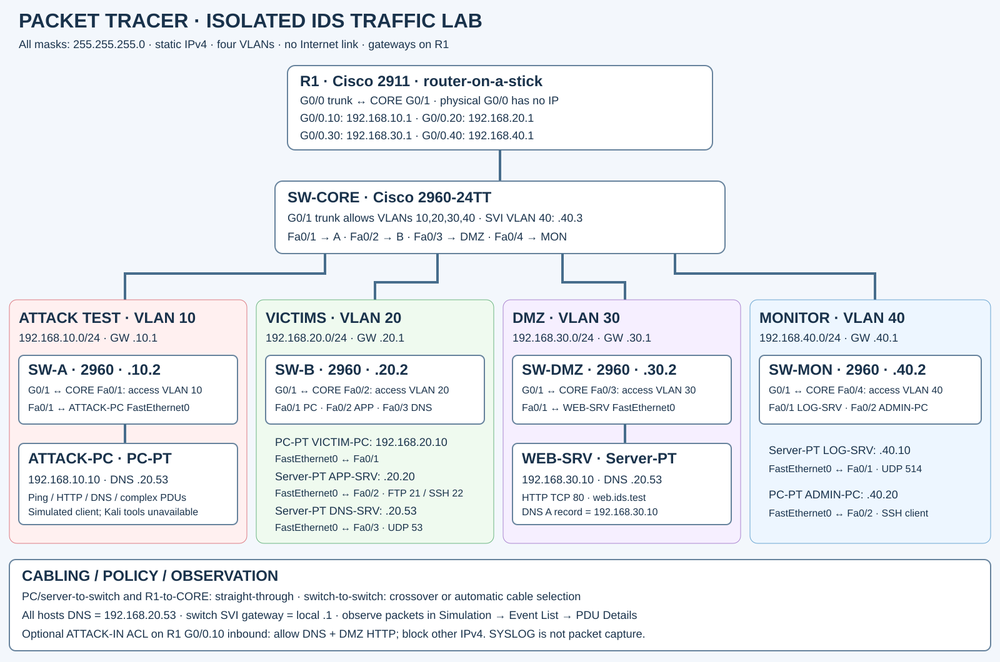

# Network Sentinel

Beginner-friendly, modular Security Monitoring / Mini-SOC platform. Packet
capture is one optional input—not the foundation of the product.

It accepts normalized security events from packet capture, Zeek, Suricata,
Windows authentication logs, or synthetic/test data. Python then applies
transparent detections and correlation, stores evidence locally, and exposes it
to the live dashboard and API. Every alert includes its reason, confidence, and
a recommended first investigation step. See [the architecture guide](docs/ARCHITECTURE.md).

## Development setup

Target runtime: Python 3.12. Create a virtual environment, install dependencies,
then run the synthetic parser tests:

```powershell
py -3.12 -m venv .venv
.\.venv\Scripts\Activate.ps1
python -m pip install -r requirements.txt
python -m pytest
```

The first implemented component is the packet parser. It converts Scapy IPv4 TCP,
UDP, ICMP, ARP, and other IP packets to `NormalizedPacket`, while safely
discarding malformed input.

## Current detection scope

The rule engine provides five transparent, configurable checks: port scans,
high initial TCP SYN activity, total packet-rate anomalies, ICMP echo sweeps,
and unusually high per-source DNS query volume. It examines packet headers and
DNS query names only; it does not inspect application payloads or claim to
classify malicious domains.

See `docs/AI_HANDOFF.md` for the small set of files another coding agent should
read before modifying detection behavior.

The source-neutral intake also supports repeated authentication failures,
suspicious success-after-failure sequences, Suricata signature alerts, and Zeek
notices. They are submitted through `POST /api/events`; `GET /api/events/recent`
lists stored event evidence.

## Packet Tracer lab bridge

The project includes [`pt_collector.py`](pt_collector.py), a small local bridge
for Cisco-style syslog, JSON-line events, and Packet Tracer text exports. Its
records enter the same SQLite/alert/dashboard pipeline through
`POST /api/events/ingest`; this endpoint accepts one strict normalized record
or `{"events": [...]}`. The dedicated low-threshold lab profile lives in
[`config.packet-tracer.yaml`](config.packet-tracer.yaml), and the safe replay
plus end-to-end check are [`pt_traffic_replay.py`](pt_traffic_replay.py) and
[`test_pipeline.py`](test_pipeline.py). See the complete
[Packet Tracer bridge guide](docs/packet-tracer/IDS_BRIDGE.md).

### Active Packet Tracer topology and addressing

The diagram below is the **active reference lab** used by
[`config.packet-tracer.yaml`](config.packet-tracer.yaml), the collector, and
the Packet Tracer replay tests. It is an editable SVG diagram rather than a
fake screenshot, so its IP addresses and device labels remain readable on
GitHub and easy to update when the lab changes.



| Zone | Network / gateway | Important devices | Purpose |
| --- | --- | --- | --- |
| Attacker test | `192.168.10.0/24` / `192.168.10.1` | `ATTACK-PC` `192.168.10.10` | Safe source for the simulated ping, DNS, and port-probe stories. |
| Internal victims | `192.168.20.0/24` / `192.168.20.1` | `VICTIM-PC` `.20.10`, `APP-SRV` `.20.20`, `DNS-SRV` `.20.53` | Windows-like target, FTP/SSH application target, and DNS target. |
| DMZ | `192.168.30.0/24` / `192.168.30.1` | `WEB-SRV` `192.168.30.10` | HTTP/HTTPS demonstration service. |
| Monitoring | `192.168.40.0/24` / `192.168.40.1` | `LOG-SRV` `.40.10`, `ADMIN-PC` `.40.20` | Syslog/collector and administration zone. |

All lab masks are `255.255.255.0`. R1 provides the four `.1` gateways; the
reference diagram uses router subinterfaces and a core trunk. If your Packet
Tracer file instead uses separate routed interfaces, keep the same addresses
and update only the physical-port notes. For a mirrored-monitoring version,
use Switch B as the source (`Gi0/1`, `Fa0/1–3`, both directions) and its
monitor destination port as the monitoring uplink; Packet Tracer simulation
details remain the authoritative visual evidence of those frames.

When you change an address, update the `packet_tracer.targets` mapping in
[`config.packet-tracer.yaml`](config.packet-tracer.yaml) first, then make the
same change in the Packet Tracer diagram/file. That keeps replay events and
lab-specific DNS/FTP/SSH detections aligned without hardcoding the addresses
in Python.

> The proprietary `.pkt` simulator file is intentionally not in this source
> repository yet. Add it only after opening it in Cisco Packet Tracer and
> confirming it is the version you want to share; the documented diagram and
> address plan above are the safe, reviewable source for the repository.

## Configure data sources

[`config.yaml`](config.yaml) is the main configuration file. It chooses enabled
inputs and sets thresholds without hardcoding an interface, operating system,
database filename, or detection setting in the rules. Environment variables
still override it for deployment, for example `CAPTURE_INTERFACE=Wi-Fi`.

Zeek and Suricata are **not installed automatically**. Their normalizers are
ready for their JSON records, but keeping them disabled makes this first version
small and safe to run. Node-RED is also optional: import
[`docs/integrations/node-red-flow.json`](docs/integrations/node-red-flow.json)
to expose a webhook that forwards normalized events to `POST /api/events`.
The Python engine works normally when Node-RED is absent.

## Run the backend API

```powershell
python -m uvicorn backend.main:app --reload
```

Open `http://127.0.0.1:8000/docs` to explore the generated API documentation.
The current API exposes monitoring controls, traffic statistics, and persisted
alert history/details.

Key endpoints: `POST /api/monitoring/start`, `POST /api/monitoring/stop`,
`GET /api/traffic/overall`, `GET /api/traffic/protocols`,
`GET /api/traffic/top-ips`, `GET /api/traffic/top-ports`,
`GET /api/traffic/connections`, `GET /api/alerts/recent`,
`GET /api/alerts/history`, and `GET /api/alerts/{alert_id}`.
Use `GET /api/monitoring/interfaces` to identify the exact Npcap adapter name
when setting `CAPTURE_INTERFACE`. The `network_name` field is the exact Npcap
device identifier; the friendly `name` (for example, `Wi-Fi`) is accepted too.

For non-capture sources, use `POST /api/events` with a `timestamp`, `source`,
and `event_type`; IP, ports, protocol, counts, and `metadata` are optional.
This is the public ingestion interface for Zeek/Suricata/Windows log adapters,
synthetic events, or Node-RED.

## Run the dashboard and live monitoring

Install [Npcap](https://npcap.com/#download) on Windows and select its
WinPcap-compatible mode during installation. Then open PowerShell **as
Administrator** in this project folder and run:

```powershell
python -m uvicorn backend.main:app --host 127.0.0.1 --port 8000
```

Or, from a normal PowerShell window, start the supplied elevated launcher:

```powershell
Start-Process powershell -Verb RunAs -ArgumentList '-ExecutionPolicy Bypass -File .\scripts\start_network_sentinel_admin.ps1'
```

Open `http://127.0.0.1:8000/`. Press **Start monitoring**. If Npcap, an
interface, or permission is unavailable, the dashboard shows an actionable
capture error instead of reporting a false active state. Optionally set
`CAPTURE_INTERFACE` to a Windows/Npcap interface name before launching.

The dashboard uses WebSockets for live updates and displays packet/byte rates,
protocols, active connections, explainable security alerts, observed devices,
ARP-conflict warnings, and a read-only local Wi-Fi security posture. An ARP
warning is evidence to investigate, never automatic proof that a device is
malicious.

Use **Run safe demo** to populate the dashboard with local synthetic port-scan,
authentication, Zeek, and Suricata examples. It does not scan, contact, or send
traffic to any device. **Import Windows logins** reads only recent Windows
Security events 4624 and 4625; Windows may require an elevated server process
to allow that read.

## IP names and country context

Top source and destination IPs now show their cached reverse-DNS/PTR hostname
in brackets when one is available. This uses the computer's configured DNS
resolver and never blocks the live dashboard. Private IPs are labelled as local
instead of being sent for lookup.

Country lookup is deliberately disabled in [`config.yaml`](config.yaml). If you
enable it, Network Sentinel sends each public IP to the configured provider
(default: `ipwho.is`) and caches the country result locally for 24 hours. Only
enable that if you are comfortable sharing observed public IP addresses with
that provider.

## Alert and port detail

When an alert comes from network telemetry, opening it shows the safe packet
header context that triggered it: traffic type, protocol, TCP flags, packet
size, source/destination ports and their common service labels, plus DNS, ICMP,
or ARP fields when relevant. Packet payloads are never stored or shown.

The **Top destination ports** list now labels familiar services such as `443
(HTTPS)` and `22 (SSH)`. Hover a label to read its plain-language purpose.
